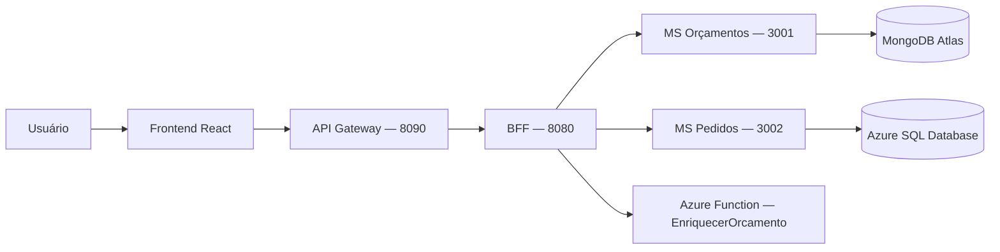

# Integrador de Orçamentos — Schulz S/A / SKA Automação

Aplicação acadêmica com dois CRUDs, persistência em nuvem, API Gateway,
BFF agregador e uma Azure Function de cálculo.

## Arquitetura



O frontend chama somente `/api` no gateway. O gateway autentica a sessão,
limita requisições e encaminha as chamadas ao BFF. O BFF consulta os dois
microserviços e, em `/api/aggregated-data`, envia os dados à Azure Function.
A resposta agrega orçamentos, pedidos e cálculo em um único JSON.

| Componente | Responsabilidade |
|---|---|
| API Gateway Express | Login, sessão, limite de requisições, roteamento e entrada central |
| BFF Express | Composição das respostas e encaminhamento dos dois CRUDs |
| Microserviço Mongo | CRUD de orçamentos em `schulz.orcamentos`, no Atlas |
| Microserviço SQL | CRUD de pedidos em `dbo.TB_PEDIDOS`, no Azure SQL |
| Azure Function HTTP | Cálculo de custos, impostos, preço do lote e enriquecimento |

A Function publica `POST /api/EnriquecerOrcamento` e exige uma chave armazenada
somente no BFF. O CRUD Mongo é executado pelo microserviço Mongo. Falhas dos
bancos são exibidas como erros, sem gravação alternativa no navegador ou JSON.
A agregação informa `status: partial` quando um serviço falha.

O gateway é um serviço Express separado do BFF. Não requer uma conta AWS.
As chamadas diretas ao BFF e aos microserviços exigem um token interno que o
frontend não recebe. No Docker Compose, apenas a porta do gateway é publicada.

## Executar neste ambiente

Pré-requisito: **Node.js 22** (`.nvmrc`). Os arquivos locais de configuração já
estão preparados neste computador. Instale as dependências, caso necessário:

```bash
npm ci --prefix Projeto
npm ci --prefix services/api-gateway
npm ci --prefix services/bff
npm ci --prefix services/ms-orcamentos-mongo
npm ci --prefix services/ms-pedidos-sql
```

Neste computador, o Node.js 22 está disponível no diretório de ferramentas
local. Se o terminal ainda usar Node.js 18, configure o PATH para esta sessão:

```bash
export PATH="$HOME/.local/share/projeto-claud-tools/node_modules/.bin:$PATH"
```

Na raiz do repositório:

```bash
npm run dev
```

O comando inicia frontend, gateway, BFF e os dois microserviços. A Azure Function
já está publicada na nuvem. Use `Ctrl+C` para encerrar os processos locais.

Acesse **http://localhost:3000**. O usuário e a senha estão em
`services/api-gateway/.env`, nas variáveis `GATEWAY_USERNAME` e
`GATEWAY_PASSWORD`. O login cria um cookie HttpOnly/SameSite Strict. As sessões
são mantidas em memória para a execução acadêmica; reiniciar o gateway encerra
as sessões. Use o mesmo hostname ao navegar entre aplicação e Swagger.

O Vite encaminha `/api` ao gateway em `http://127.0.0.1:8090`. Depois do build,
o gateway também serve o frontend compilado em **http://localhost:8090**.
As duas formas de acesso usam a mesma entrada de API.

## Configurar outro ambiente

Copie os arquivos `.env.example` dos serviços para `.env` e preencha:

| Arquivo | Variáveis |
|---|---|
| `services/api-gateway/.env` | `BFF_URL`, `GATEWAY_USERNAME`, `GATEWAY_PASSWORD`, `INTERNAL_API_TOKEN` |
| `services/bff/.env` | `MS_MONGO_URL`, `MS_SQL_URL`, `AZURE_FUNCTION_URL`, `AZURE_FUNCTION_KEY`, `INTERNAL_API_TOKEN` |
| `services/ms-orcamentos-mongo/.env` | `MONGO_URI`, banco/coleção e `INTERNAL_API_TOKEN` |
| `services/ms-pedidos-sql/.env` | `SQL_SERVER`, `SQL_DATABASE`, `SQL_USER`, `SQL_PASSWORD`, `INTERNAL_API_TOKEN` |

Use o mesmo token interno aleatório nos quatro serviços. As credenciais de
banco e a chave da Function pertencem aos backends. O frontend usa apenas
`VITE_API_BASE_URL=/api`; não coloque segredos em variáveis `VITE_*`.

Para HTTPS, configure `GATEWAY_COOKIE_SECURE=true` e os domínios permitidos em
`ALLOWED_ORIGINS`. O ambiente local usa HTTP e cookie sem a flag Secure.

A configuração inicial da tabela e a importação dos pedidos locais estão em
[services/ms-pedidos-sql/README.md](services/ms-pedidos-sql/README.md).

## APIs e Swagger

Depois de entrar na aplicação, abra:

| Serviço | Swagger pelo gateway |
|---|---|
| Orçamentos | http://localhost:3000/api/docs/mongo/ |
| Pedidos | http://localhost:3000/api/docs/sql/ |
| BFF | http://localhost:3000/api/docs/bff/ |

Em execução pelo frontend compilado/Docker, use a porta **8090** nos mesmos
caminhos. As documentações usam a sessão autenticada da aplicação.

| Método | Endpoint público | Operação |
|---|---|---|
| POST / GET / DELETE | `/api/session` | Entrar, consultar sessão, sair |
| GET / POST | `/api/orcamentos` | Listar/criar orçamento |
| GET / PUT / DELETE | `/api/orcamentos/:id` | Consultar/editar/excluir orçamento |
| GET / POST | `/api/pedidos` | Listar/criar pedido |
| GET / PUT / DELETE | `/api/pedidos/:id` | Consultar/editar/excluir pedido |
| GET | `/api/aggregated-data` | JSON consolidado dos três componentes |

A tela **Visão BFF** mostra os estados reais dos serviços e o JSON recebido.
O cálculo respeita o lote, a flag de custo zerado, a margem e os impostos.

## Recursos Azure

| Recurso | Configuração |
|---|---|
| Function App | `cloud-projeto-orc-f-app` — Node.js 22 / Azure Functions v4 |
| Endpoint | `https://cloud-projeto-orc-f-app.azurewebsites.net/api/EnriquecerOrcamento` |
| SQL Server | `sql-schulz-alex-b6fa36.database.windows.net` |
| Banco SQL | `schulz-pedidos` |
| Grupo / região | `cloudprojetoorcfapp` / Canadá Central |
| SQL gratuito | General Purpose Serverless, `useFreeLimit=true`, `AutoPause` ao atingir a cota |

O SQL também pausa após 60 minutos sem atividade. O acesso SQL do computador
está limitado pela regra de firewall `ProjetoClaudLocal`. Se o IP público mudar,
atualize essa regra. A primeira conexão após uma pausa pode exigir nova tentativa.

A opção “1 DTU” não está disponível na assinatura/região consultada. O projeto
mantém a oferta gratuita serverless, conforme a escolha feita para este ambiente.
Não há conversão para um plano DTU pago.

## Docker

```bash
docker compose up --build
```

Acesse http://localhost:8090. O gateway serve a interface compilada e a API.
Os quatro arquivos `.env` dos serviços precisam estar configurados antes de
iniciar. A Function continua publicada na Azure, e os bancos continuam na nuvem.

## Testes

```bash
npm test
# Com todos os serviços locais em execução:
npm run test:integration
```

A integração testa os dois CRUDs pelo gateway, confirma as alterações com os
drivers dos bancos e verifica a resposta de cálculo da Function. Os registros
temporários são removidos, preservando os registros anteriores.

## Publicação

O workflow `.github/workflows/deploy.yml` publica apenas os arquivos estáticos
do frontend. Para a aplicação completa autenticada, publique o frontend e o
gateway na mesma origem HTTP(S), como na imagem Docker do gateway.

O projeto `functions/` é publicado separadamente com build remoto. O ZIP deve
ter `host.json`, `package.json`, `package-lock.json` e `src/` na raiz; nunca inclua
`local.settings.json` ou `.env`. Após publicar, configure a chave da Function no
`.env` do BFF. Não exponha essa chave no frontend.

## Documentos do projeto

- [GRUPO.md](GRUPO.md)
- [PROMPT.md](PROMPT.md)
- [Contexto PJBL](contexto/CONTEXTO_PROJETO_PJBL.md)
- [Checklist PJBL](contexto/CHECKLIST_ENTREGA_PJBL.md)
- [Gateway](services/api-gateway/README.md)
- [BFF](services/bff/README.md)
- [Microserviço Mongo](services/ms-orcamentos-mongo/README.md)
- [Microserviço SQL](services/ms-pedidos-sql/README.md)

Referências: [padrão BFF](https://learn.microsoft.com/en-us/azure/architecture/patterns/backends-for-frontends),
[segurança Express](https://expressjs.com/en/advanced/best-practice-security/) e
[oferta gratuita Azure SQL](https://learn.microsoft.com/en-us/azure/azure-sql/database/free-tier).
