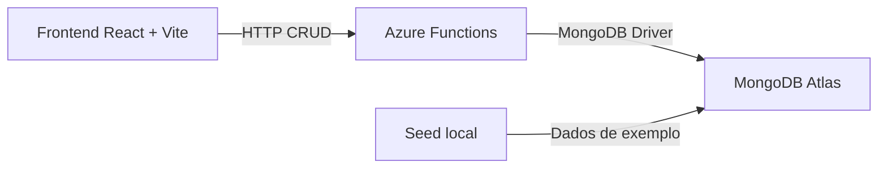

# Integrador de Orçamentos — Schulz S/A / SKA Automação

> Projeto acadêmico PJBL composto por um frontend React e uma API serverless em Azure Functions, com persistência no MongoDB Atlas.

## Arquitetura



O frontend não acessa o MongoDB diretamente. Ele chama as Azure Functions `GetOrcamentos`, `CreateOrcamento`, `UpdateOrcamento` e `DeleteOrcamento`; as Functions fazem a persistência na coleção de orçamentos do Atlas.

## Estrutura do repositório

```text
Projeto_Claud/
├── Projeto/                       # Frontend React/Vite
│   ├── src/components/            # Componentes compartilhados de interface
│   ├── src/features/orcamentos/   # Slice vertical do domínio de orçamentos
│   │   ├── domain/                # Regras puras de domínio e cálculo de custos
│   │   ├── application/           # Casos de uso e montagem do orçamento inicial
│   │   ├── infrastructure/        # Gateway HTTP para Azure Functions
│   │   ├── presentation/          # Telas e componentes do módulo
│   │   └── composition/           # Composição das dependências do frontend
│   ├── src/data/                  # Dados auxiliares locais
│   └── scripts/seedMongoAtlas.mjs # Seed do MongoDB Atlas
├── functions/                     # Aplicação Azure Functions (Node.js v4)
│   ├── src/
│   │   ├── index.js                # Bootstrap e registro explícito das Functions
│   │   ├── shared/                 # Infraestrutura MongoDB e respostas HTTP
│   │   └── features/orcamentos/    # Slices create/list/update/delete com domínio, adaptadores e casos de uso
│   ├── host.json
│   ├── local.settings.example.json
│   └── package.json
├── .github/workflows/deploy.yml   # Deploy apenas do frontend no GitHub Pages
├── GRUPO.md
└── PROMPT.md
```

## Tecnologias

- **Frontend:** React 18, Vite 6, Tailwind CSS e Lucide React.
- **Backend:** Azure Functions Node.js v4 e driver oficial do MongoDB.
- **Banco de dados:** MongoDB Atlas.
- **Publicação do frontend:** GitHub Pages via GitHub Actions.

## Executar localmente

### Frontend local usando a Function publicada na Azure

Esse modo executa os endpoints de orçamentos na nuvem. Não exige Core Tools
nem `func start` no computador. Os módulos de pedidos e agregação continuam
dependendo dos serviços/BFF, pois não são implementados pelas quatro Functions.

1. No [MongoDB Atlas](https://cloud.mongodb.com/), crie ou reutilize um cluster
   ativo. Para desenvolvimento, selecione a opção **Free / M0**. Crie um usuário
   de banco com permissão `readWrite` no banco `schulz` e guarde sua senha.
2. Na lista de acesso de rede do Atlas, autorize os endereços de saída da
   Function App. Autorize também seu IP atual se for conectar pelo computador
   para diagnóstico ou seed. O IP de entrada da Function não é o IP de saída;
   dependendo do plano, os IPs de saída podem mudar com a escala. Consulte a
   [documentação de IPs do Azure Functions](https://learn.microsoft.com/en-us/azure/azure-functions/ip-addresses).
3. No cluster, abra **Connect → Drivers → Node.js** e copie a URI fornecida pelo
   Atlas, preenchendo o usuário e a senha. Codifique caracteres especiais da
   senha para uso em URL. Não use os endereços antigos deste repositório como
   modelo de hostname.
4. No [portal Azure](https://portal.azure.com/), abra a Function App e vá a
   **Settings → Environment variables → App settings**. Configure e salve:

   ```dotenv
   MONGO_URI=<URI completa do Atlas, com usuário e senha>
   MONGO_DB_NAME=schulz
   MONGO_ORCAMENTOS_COLLECTION=orcamentos
   ```

   A URI fica no backend. Não crie variáveis `VITE_*` com credenciais de banco.
   `functions/local.settings.json` configura somente a execução local; editar
   esse arquivo não atualiza a Function publicada.
5. Na Function App, confirme que `GetOrcamentos`, `CreateOrcamento`,
   `UpdateOrcamento` e `DeleteOrcamento` estão publicadas. Em `GetOrcamentos`,
   use **Get function URL** para obter o endereço atual. Configure o CORS da
   Function App para permitir `http://localhost:3000`.
6. Em `Projeto/.env`, configure a base obtida no portal, terminando em `/api`:

   ```dotenv
   VITE_AZURE_FUNCTIONS_BASE_URL=https://<hostname atual da Function App>/api
   ```

   Se existir `Projeto/.env.development.local`, remova as quatro variáveis
   `VITE_AZURE_GET_ORCAMENTOS_URL`, `VITE_AZURE_CREATE_ORCAMENTO_URL`,
   `VITE_AZURE_UPDATE_ORCAMENTO_URL` e `VITE_AZURE_DELETE_ORCAMENTO_URL` que
   apontam para o BFF local. Elas têm precedência sobre a URL base.
7. Reinicie o frontend com `npm --prefix Projeto run dev`. Confira no painel
   Network do navegador se a requisição a `GetOrcamentos` usa o hostname da
   Azure e retorna HTTP 200 com o campo `orcamentos`.

O frontend possui fallback em cache: exibir os dados de exemplo não comprova
que a Function ou o Atlas estão conectados. Valide a resposta HTTP real antes
de considerar a integração concluída. O seed abaixo substitui documentos com
os mesmos IDs; execute-o apenas quando quiser carregar os exemplos nesse banco.

Referências: [criar cluster Atlas](https://www.mongodb.com/docs/atlas/tutorial/deploy-free-tier-cluster/),
[conectar ao Atlas](https://www.mongodb.com/docs/atlas/connect-to-database-deployment/) e
[configurar a Function App](https://learn.microsoft.com/en-us/azure/azure-functions/functions-how-to-use-azure-function-app-settings).

### Aplicação com os microserviços locais (sem Docker ou credenciais de nuvem)

Além das Azure Functions, o repositório contém dois microserviços Express em
`services/` e um BFF. Para executar essa opção, use os comandos abaixo a partir
da raiz do repositório. Node.js e npm são os únicos pré-requisitos.

Instale as dependências e configure o frontend uma vez:

```bash
npm ci --prefix Projeto
npm ci --prefix services/ms-orcamentos-mongo
npm ci --prefix services/ms-pedidos-sql
npm ci --prefix services/bff
cp Projeto/.env.development.example Projeto/.env.development.local
```

Execute cada comando em um terminal separado, mantendo os quatro abertos:

```bash
# Terminal 1 — Orçamentos (porta 3001)
npm --prefix services/ms-orcamentos-mongo start

# Terminal 2 — Pedidos (porta 3002)
npm --prefix services/ms-pedidos-sql start

# Terminal 3 — BFF (porta 8080)
npm --prefix services/bff start

# Terminal 4 — Frontend (porta 3000)
npm --prefix Projeto run dev
```

Acesse **http://localhost:3000**. O Swagger do BFF está em
http://localhost:8080/api-docs e a agregação em
http://localhost:8080/api/aggregated-data. Use `Ctrl+C` em cada terminal para parar.

Sem `MONGO_URI`/`MONGODB_URI` no ambiente do serviço, os orçamentos são salvos em
`services/ms-orcamentos-mongo/data/orcamentos.json`. O serviço de pedidos usa
`services/ms-pedidos-sql/data/tb_pedidos.sql.json`: a implementação atual simula
operações SQL em JSON e não se conecta ao Azure SQL. O BFF tenta consultar a
Azure Function remota e usa regras locais se ela estiver indisponível. Alguns
rótulos da interface ainda mencionam Azure/Atlas mesmo nessa configuração local.

O arquivo `.env.development.local` é ignorado pelo Git e vale somente para
`npm run dev`, preservando a configuração de build. Para voltar a usar os
endpoints Azure, remova esse arquivo e reinicie o Vite.

### Alternativa: frontend com Azure Functions e MongoDB Atlas

### 1. Frontend

```bash
cd Projeto
npm ci
npm run dev
```

O frontend usa, por padrão, a URL de produção configurada em `Projeto/src/features/orcamentos/infrastructure/azure-orcamento-gateway.js`. Para apontá-lo a outro ambiente, defina `VITE_AZURE_FUNCTIONS_BASE_URL` em `Projeto/.env` com o sufixo `/api`.

### 2. Azure Functions

Pré-requisitos: Node.js e Azure Functions Core Tools v4.

```bash
cd functions
npm ci
cp local.settings.example.json local.settings.json
```

Edite `functions/local.settings.json` e informe pelo menos a variável `MONGO_URI`. Em seguida, inicie a API:

```bash
npm start
```

Por padrão, as Functions locais são expostas em `http://localhost:7071/api`. Para conectar o frontend local a elas, adicione esta linha a `Projeto/.env`:

```dotenv
VITE_AZURE_FUNCTIONS_BASE_URL=http://localhost:7071/api
```

### 3. Popular o MongoDB Atlas com os dados de exemplo

O seed utiliza `functions/package.json` para carregar o driver MongoDB e lê os orçamentos de `Projeto/mock-bd.js`.

```bash
cd Projeto
npm run seed:mongo
```

Configure `MONGO_URI` (ou `MONGODB_URI`) em `Projeto/.env` antes de rodar o comando. As credenciais não devem ser versionadas.

## Deploy

O workflow `.github/workflows/deploy.yml` permanece responsável somente pelo build e deploy do frontend `Projeto/` no GitHub Pages. O deploy das Azure Functions deve ser configurado separadamente com as credenciais da Azure Function App, pois elas não estão presentes neste repositório.

### Recriar uma Function App apagada

Ambiente recriado em 12/11/2026:

| Recurso | Valor |
|---|---|
| Function App | `cloud-projeto-orc-f-app` |
| Grupo de recursos | `cloudprojetoorcfapp` |
| Região | Canadá Central (`canadacentral`) |
| Runtime | Node.js 22, Azure Functions v4 |
| Plano | Flex Consumption, 512 MB, sem instâncias Always Ready |
| Base da API | `https://cloud-projeto-orc-f-app.azurewebsites.net/api` |

O código das quatro Functions está em `functions/src/` e é registrado por
`functions/src/index.js`. Publique esse projeto inteiro em uma nova Function
App: não é necessário criar cada endpoint manualmente no portal.

No portal Azure, crie uma **Function App**, selecione sua assinatura e um grupo
de recursos, escolha um nome globalmente único e use **Node.js 22 / Linux**.
O plano **Flex Consumption** permite executar sob demanda; a disponibilidade
de regiões e as cotas dependem da assinatura. A criação também requer uma conta
de armazenamento. Confira o resumo de recursos e preços exibido pelo portal.

Para publicar o pacote de código pelo Azure CLI (também disponível no Cloud
Shell), use os nomes reais do recurso e do grupo:

```bash
az functionapp deployment source config-zip \
  --resource-group <GRUPO_DE_RECURSOS> \
  --name <NOME_DA_FUNCTION_APP> \
  --src <CAMINHO_DO_ZIP> \
  --build-remote true
```

O ZIP deve ter `host.json`, `package.json`, `package-lock.json` e `src/` na
raiz, sem a pasta externa `functions/`. O build remoto instala as dependências
Node na Azure. Não inclua `local.settings.json` ou arquivos `.env` no pacote.

Depois de publicar, configure `MONGO_URI`, `MONGO_DB_NAME` e
`MONGO_ORCAMENTOS_COLLECTION` e o CORS conforme o roteiro acima. Confirme que
os quatro endpoints aparecem na Function App, obtenha o hostname real no
portal e atualize `VITE_AZURE_FUNCTIONS_BASE_URL` no frontend. Sem a conexão
válida com o Atlas, as Functions podem carregar, mas o CRUD não funciona.

Referências: [criar Function App com Flex Consumption](https://learn.microsoft.com/en-us/azure/azure-functions/flex-consumption-how-to)
e [publicar um pacote ZIP](https://learn.microsoft.com/en-us/azure/azure-functions/deployment-zip-push).

## Segurança de configurações

- `functions/local.settings.json` fica ignorado pelo Git; use `functions/local.settings.example.json` como modelo.
- `Projeto/.env` também fica ignorado pelo Git.
- Nunca inclua URI, usuário, senha ou chave de Function nos arquivos versionados.

## Documentos entregues e controle

- [GRUPO.md](GRUPO.md)
- [PROMPT.md](PROMPT.md)
- [Contexto Geral e Requisitos PJBL](contexto/CONTEXTO_PROJETO_PJBL.md)
- [Checklist Oficial de Entrega (Tracker de Progresso)](contexto/CHECKLIST_ENTREGA_PJBL.md)
