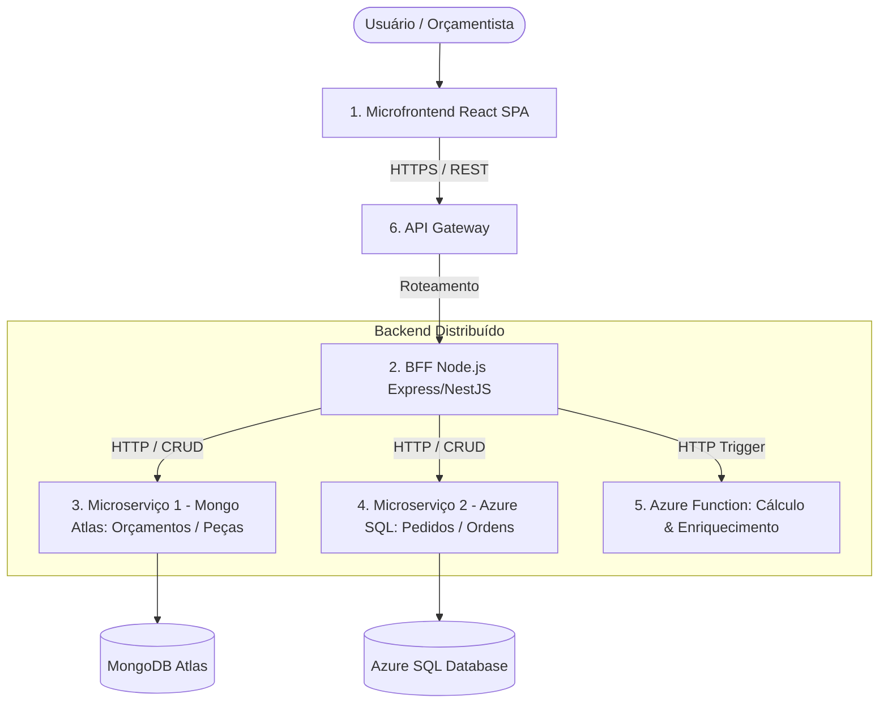

# 📋 DOCUMENTO MESTRE DE CONTEXTO E DEFINIÇÃO DE PRONTO (PJBL — ARQUITETURA COMPLETA)

> **Finalidade deste documento:** Este arquivo serve como contexto universal e briefing executivo do projeto. Ele foi projetado para ser copiado ou fornecido como entrada em qualquer sessão de chat com Inteligência Artificial (ou novos desenvolvedores), garantindo que todo o trabalho subsequente siga rigorosamente o mesmo alinhamento de escopo, regras de negócio, padrões arquiteturais e critérios de aceite da entrega final do PJBL.

---

## 📌 1. Identificação Geral do Projeto

* **Nome do Sistema:** Integrador de Orçamentos
* **Cliente:** Schulz S/A (Fabricante de compressores e autopeças industriais de Joinville/SC)
* **Fornecedora/Desenvolvedora:** SKA Automação de Engenharias Ltda.
* **Disciplina / Contexto Acadêmico:** Projeto Prático PJBL (Problem-Based Learning) — Arquitetura de Software e Soluções Cloud
* **Integrantes da Equipe (Obrigatório constar em todos os artefatos):**
  * Alexandre Filho
  * Ana Julia
  * Felipe Nathan
  * Matheus Silva
* **Repositório Central Atual:** `https://github.com/ttheus27/Projeto_Claud`
* **Frontend em Produção (GitHub Pages):** `https://ttheus27.github.io/Projeto_Claud/`
* **Azure Function App Ativa:** `https://func-schulz-matheus-dxafhzd5hkchhgc7.canadaeast-01.azurewebsites.net/api/`

---

## 🏭 2. Contexto de Negócio e Domínio Industrial (Schulz S/A)

A **Schulz S/A** opera na usinagem e fundição pesada de autopeças (virabrequins forjados, suportes de pinça de freio, carcaças de compressores de parafuso e pistões). 
O **Integrador de Orçamentos** substitui o legado de planilhas locais (.xlsx/.ods) e um sistema desktop WinForms, centralizando o levantamento técnico, desenho técnico 2D, cálculo de custos e a emissão da proposta formal.

### Regra de Ouro do Domínio (RF03 — Flag "Zerar Custo"):
* Operações bonificadas, retrabalhos internos ou inspeções metrológicas de qualidade (ex: Inspeção CMM) **não podem ser cobradas do cliente final**, mas **o tempo de máquina e setup deve ser contabilizado** para o planejamento da capacidade fabril da fábrica.
* Ao marcar a flag `zerarCusto = true` em uma operação da folha de processos:
  * `custoEfetivo = 0.00` (não compõe o preço final).
  * O tempo de ciclo, tempo de setup e subtotal nominal continuam sendo exibidos (riscados/anotados) para planejamento de produção.
  * O recálculo de preço unitário, impostos e margem de lucro deve ser instantâneo.

### Regra de Precificação e Cálculos:
1. $\text{Custo Setup Total} = \left(\frac{\text{tempoSetupMin}}{60}\right) \times (\text{custoHoraMaquina} + \text{custoHoraHomem})$
2. $\text{Custo Setup Unitário} = \frac{\text{Custo Setup Total}}{\text{lotePadrao}}$ (amortizado no lote)
3. $\text{Custo Ciclo Unitário} = \left(\frac{\text{tempoCicloMin}}{60}\right) \times (\text{custoHoraMaquina} + \text{custoHoraHomem})$
4. $\text{Subtotal Nominal} = \text{Custo Setup Unitário} + \text{Custo Ciclo Unitário} + \text{custoFerramentalItem}$
5. $\text{Custo Efetivo} = \text{zerarCusto} \,?\, 0 : \text{Subtotal Nominal}$
6. $\text{Custo Direto Unitário} = \text{custoMateriaPrima} + \sum(\text{custosEfetivos})$
7. $\text{Valor com Margem} = \text{Custo Direto Unitário} \times \left(1 + \frac{\text{margemLucroPercentual}}{100}\right)$
8. $\text{Preço Final Unitário} = \frac{\text{Valor com Margem}}{1 - \left(\frac{\text{impostosPercentual}}{100}\right)}$ (cálculo de impostos "por dentro")
9. $\text{Preço Total Lote} = \text{Preço Final Unitário} \times \text{lotePadrao}$

---

## 🧱 3. O Que JÁ TEMOS Implementado (Baseline Atual)

1. **Frontend SPA React 18 + Vite 6 + Tailwind CSS (`Projeto/`):**
   - Dashboard com listagem, busca e KPIs em tempo real.
   - Folha de processo e detalhe do orçamento com recálculo instantâneo da flag *Zerar Custo*.
   - Visualizador de desenho técnico vetorial SVG 2D (cotas, tolerâncias ISO 2768-mK, rugosidade Ra).
   - Módulo `Integrador_Reports` com proposta formal paginada para impressão em A4 e exportação em JSON.
   - Modal de importação com validação de dados de planilhas.
   - Padrão **Clean Architecture** e **Vertical Slice** na pasta `Projeto/src/features/orcamentos/`.
   - CI/CD via GitHub Actions no arquivo `.github/workflows/deploy.yml` publicando no GitHub Pages.
   - Testes unitários com **Vitest** criados (cálculo de custos, casos de uso e renderização do dashboard).
2. **Serverless Azure Functions v4 Node.js (`functions/`):**
   - 4 funções HTTP triggers: `GetOrcamentos`, `CreateOrcamento`, `UpdateOrcamento`, `DeleteOrcamento`.
   - Conexão e persistência ativa no **MongoDB Atlas** (banco `schulz`, coleção `orcamentos`).
   - Reutilização da conexão do cliente Mongo entre invocações de worker.
   - Script de carga e seed idempotente (`scripts/seedMongoAtlas.mjs`).
3. **Documentação de Arquitetura Existente:**
   - `contexto/Documento_Arquitetura_Arc42_Integrador_Orcamentos.pdf` (Versão 2.0 com 62 páginas): cobre o modelo C4 (níveis 1 a 4), diagramas UML 2.5, DER e ADRs.
   - `GRUPO.md`, `README.md`, `PROMPT.md`.

---

## 🎯 4. Requisitos Mandatórios da Entrega Completa (PJBL — Entrega 3)

Segundo o regulamento em `contexto/pjbl.md`, a entrega final exige uma **Arquitetura Distribuída Completa**, não sendo mais aceita a arquitetura parcial simplificada. A entrega é composta por:



### Componentes Obrigatórios e suas Responsabilidades:

#### 1. Microfrontend (SPA React)
* Interface do usuário desacoplada.
* **Regra estrita:** Consome **exclusivamente o BFF / API Gateway** (não faz chamadas diretas aos microsserviços nem ao banco de dados).
* Contém aba/tela para exibir a visão unificada do endpoint `/aggregated-data`.

#### 2. BFF (Backend for Frontend — Node.js)
* Implementado preferencialmente em Node.js (Express ou NestJS).
* **Endpoint Mandatório Obrigatório:**
  * `GET /aggregated-data`: Dispara requisições paralelas para:
    1. Microserviço 1 (MongoDB)
    2. Microserviço 2 (Azure SQL)
    3. Azure Function (HTTP Trigger de cálculo/enriquecimento)
    * Agrega e retorna todos os dados combinados em um único payload JSON estruturado.
* Atua como proxy de requisições (CRUD) para os microsserviços subjacentes.
* Documentado com **Swagger/OpenAPI** próprio.
* Dockerizado com imagem publicada no Docker Hub.

#### 3. Microserviço 1 (MongoDB Atlas — Domínio: Orçamentos / Peças)
* Banco: MongoDB Atlas (Free Tier).
* Responsável pelo domínio principal de peças e folhas de processo de orçamento.
* CRUD completo (Create, Read, Update, Delete).
* Documentado com **Swagger/OpenAPI**.
* Dockerizado com imagem publicada no Docker Hub.

#### 4. Microserviço 2 (Azure SQL Database — Domínio: Pedidos / Ordens de Compra)
* Banco: Azure SQL Database (Free 1 DTU).
* Responsável por um domínio complementar (ex: `Pedidos` ou `OrdensDeFabricacao` vinculadas a um orçamento, prazos de entrega e cliente).
* CRUD completo (Create, Read, Update, Delete).
* Documentado com **Swagger/OpenAPI**.
* Dockerizado com imagem publicada no Docker Hub.

#### 5. Azure Function (Serverless)
* Tipo: HTTP Trigger Serverless.
* Responsável por processamento dedicado: cálculo de frete industrial, consolidação tributária ou validação/enriquecimento da regra da flag *Zerar Custo*.
* Exposta via endpoint HTTP público na nuvem Azure.

#### 6. API Gateway
* Exigido na entrega (ex: AWS API Gateway, Azure API Management ou Gateway de borda).
* Responsável por roteamento, centralização do tráfego e políticas de CORS/segurança.

#### 7. Dockerização e Docker Hub
* Para cada serviço independente (**BFF**, **Microserviço 1**, **Microserviço 2**):
  * `Dockerfile` construído e testado.
  * Publicação no Docker Hub no formato: `<usuario-docker>/<servico>:<tag>`.

#### 8. Padrões de Código e Testes
* **Clean Architecture:** Camadas explícitas (Domain, Application, Infrastructure, API).
* **Vertical Slice:** Organização por fatias funcionais de negócio.
* **Testes Automatizados:** Testes unitários de regras de negócio e testes de arquitetura.

#### 9. Repositórios GitHub
* Publicação em repositórios públicos no GitHub (Microfrontend, BFF, Microserviço Mongo, Microserviço SQL, Azure Function). Cada um com seu `README.md` explicativo (como rodar local, tecnologias, nomes dos alunos e links de produção).

#### 10. Documento Arc42 (Entrega 3 em PDF)
* PDF oficial com template Arc42 atualizado para a versão da Arquitetura Completa:
  * **Atualização de ADRs:** Converter as ADRs que recusavam BFF/Microsserviços/SQL para **ADRs de Adoção** da arquitetura distribuída.
  * **Diagramas C4 Model Atualizados:** Contexto (Nível 1), Contêineres (Nível 2) exibindo todos os componentes distribuídos, e Componentes (Nível 3).
  * **Software Architecture Canvas** atualizado.
  * **Seção de Links Obrigatórios:**
    * Repositórios GitHub
    * Imagens no Docker Hub
    * Links dos Swagger UIs (BFF, Microservices)
    * Link do Microfrontend em produção
    * Link do API Gateway
    * Link do Vídeo no YouTube
  * **Evidências Visuais (Prints):**
    * Print do Swagger do BFF
    * Prints do Swagger dos Microserviços 1 e 2
    * Print do Frontend em funcionamento consumindo a nuvem
    * Print da tela do API Gateway

#### 11. Vídeo de Apresentação no YouTube
* Vídeo **Não Listado** no YouTube.
* **Critério de Avaliação Crítico:** **Todos os 4 integrantes da equipe devem falar** (Alexandre, Ana Julia, Felipe e Matheus), deixando explícita a participação de cada um.
* **URLs de Nuvem:** O vídeo **deve demonstrar as URLs reais da internet/cloud** (GitHub Pages, Gateway, Swagger Cloud), **não podendo ser demonstrado apenas em localhost**.
* Roteiro obrigatório do vídeo:
  1. Frontend funcionando na nuvem.
  2. Chamadas passando pelo BFF e pelo Gateway.
  3. CRUDs e regras de negócio funcionando (incluindo a flag Zerar Custo).
  4. Demonstração das integrações reais: MongoDB Atlas, Azure SQL Server e Azure Function.
  5. Demonstração do endpoint `/aggregated-data` retornando o JSON consolidado.

---

## 📑 5. Contrato do Endpoint Obrigatório `GET /aggregated-data`

O BFF deve disponibilizar este endpoint agregando as três fontes de dados em um formato padronizado:

```json
{
  "timestamp": "2026-11-05T20:00:00.000Z",
  "status": "success",
  "data": {
    "orcamento": {
      "id": "ORC-2026-0001",
      "cliente": "Mercedes-Benz do Brasil",
      "peca": "Virabrequim 6 Cilindros Forjado",
      "lote": 500,
      "custoMateriaPrima": 450.00,
      "operacoes": [
        {
          "codigo": "OP-10",
          "descricao": "Torneamento de desbaste",
          "zerarCusto": false,
          "custoEfetivo": 128.50
        },
        {
          "codigo": "OP-50",
          "descricao": "Inspeção Metrológica CMM (Bonificada)",
          "zerarCusto": true,
          "custoEfetivo": 0.00
        }
      ],
      "origem": "Microservico-MongoDB-Atlas"
    },
    "pedidosAssociados": [
      {
        "idPedido": "PED-9841",
        "codigoOrcamento": "ORC-2026-0001",
        "dataEntrega": "2026-12-15",
        "quantidade": 500,
        "statusProducao": "Em Planejamento",
        "origem": "Microservico-Azure-SQL"
      }
    ],
    "enriquecimentoServerless": {
      "indiceAprovacaoMargem": "APROVADO_DIRETORIA",
      "taxaRiscoLogistica": 1.025,
      "aliquotaTributariaEfetiva": 0.165,
      "dataCalculo": "2026-11-05T20:00:01.000Z",
      "origem": "Azure-Function-HTTP-Trigger"
    }
  }
}
```

---

## ✅ 6. Checklist de "Definição de Pronto" (Definition of Done)

Utilize este checklist para acompanhar o progresso até a conclusão total:

### 🧹 [Fase 1] Limpeza e Preparação do Repositório
- [ ] Mover os arquivos de teste unitário (`*.test.js`, `*.test.jsx`) da subpasta acidental `Projeto/Projeto/` para `Projeto/`.
- [ ] Remover a pasta aninhada duplicada `Projeto/Projeto/` e commitar a limpeza.
- [ ] Executar `npm test` na pasta `Projeto/` e garantir que todos os testes passem com 100% de sucesso.
- [ ] Isolar a Azure Function em `functions/` para responder com a lógica de enriquecimento/cálculo do endpoint serverless.

### ⚙️ [Fase 2] Microsserviços e BFF
- [ ] **MS1 (MongoDB):** Criar serviço Node.js independente com CRUD de Orçamentos/Peças conectado ao Atlas.
- [ ] **MS1 (MongoDB):** Configurar Swagger em `/api-docs`.
- [ ] **MS2 (Azure SQL):** Provisionar Azure SQL Database (Free Tier 1 DTU).
- [ ] **MS2 (Azure SQL):** Criar serviço Node.js independente com CRUD de Pedidos conectado ao Azure SQL.
- [ ] **MS2 (Azure SQL):** Configurar Swagger em `/api-docs`.
- [ ] **BFF:** Criar aplicação Node.js (Express ou NestJS).
- [ ] **BFF:** Implementar rota obrigatória `GET /aggregated-data` (orquestra MS1 + MS2 + Function).
- [ ] **BFF:** Implementar rotas de proxy de CRUD para o frontend.
- [ ] **BFF:** Configurar Swagger do BFF em `/api-docs`.

### 🐳 [Fase 3] Dockerização e Nuvem
- [ ] Criar `Dockerfile` para o BFF.
- [ ] Criar `Dockerfile` para o Microserviço 1 (Mongo).
- [ ] Criar `Dockerfile` para o Microserviço 2 (SQL).
- [ ] Fazer build e push das 3 imagens para o Docker Hub público com tags versionadas (ex: `:v1`).
- [ ] Fazer deploy dos serviços em provedor cloud (ex: Render, Railway, Azure Container Apps ou AWS ECS).
- [ ] Configurar o API Gateway apontando o tráfego público para o BFF.

### 💻 [Fase 4] Integração do Frontend
- [ ] Atualizar o gateway HTTP do frontend (`azure-orcamento-gateway.js` ou novo `bff-gateway.js`) para consumir o Gateway/BFF.
- [ ] Criar no frontend uma aba ou seção ("Painel Integrado") para demonstrar a consulta em tempo real a `GET /aggregated-data`.
- [ ] Atualizar o build e validar a publicação no GitHub Pages.

### 📚 [Fase 5] Documentação Arc42 e Submissão
- [ ] Atualizar o documento Arc42 em PDF para a **Versão 3.0**:
  - [ ] Transformar ADRs antigas de não-adoção em ADRs de adoção da arquitetura distribuída.
  - [ ] Atualizar diagramas C4 (Contexto, Contêineres, Componentes).
  - [ ] Inserir prints dos 3 Swaggers (BFF, MS1, MS2).
  - [ ] Inserir print do Frontend em nuvem.
  - [ ] Inserir print do API Gateway configurado.
  - [ ] Inserir tabela de links (GitHub, Docker Hub, Swaggers, Frontend, Vídeo).
- [ ] Gravar o vídeo no YouTube (Não Listado):
  - [ ] Todos os 4 alunos falando (Alexandre, Ana Julia, Felipe, Matheus).
  - [ ] Demonstrar URLs de produção na internet (sem localhost).
  - [ ] Demonstrar o fluxo completo: Frontend -> Gateway -> BFF -> MS Mongo + MS SQL + Azure Function.
- [ ] Submeter o PDF único dentro do prazo no AVA.

---

## 💡 7. Instruções para Prompts em Outros Chats com IA

Quando for iniciar um novo chat ou pedir auxílio em qualquer etapa deste projeto, utilize a seguinte introdução para manter a consistência absoluta:

> *"Estou trabalhando no projeto acadêmico PJBL 'Integrador de Orçamentos' (Schulz S/A e SKA Automação). O documento com todas as diretrizes, regras de negócio da usinagem, padrões arquiteturais (Clean Architecture, Vertical Slice, BFF, Microserviços Mongo e SQL, Azure Function, Gateway e Docker Hub) e o checklist de Definition of Done está detalhado no arquivo `contexto/CONTEXTO_PROJETO_PJBL.md`. Por favor, leia e siga estritamente essas diretrizes para a seguinte tarefa: [INSERIR TAREFA AQUI]"*
