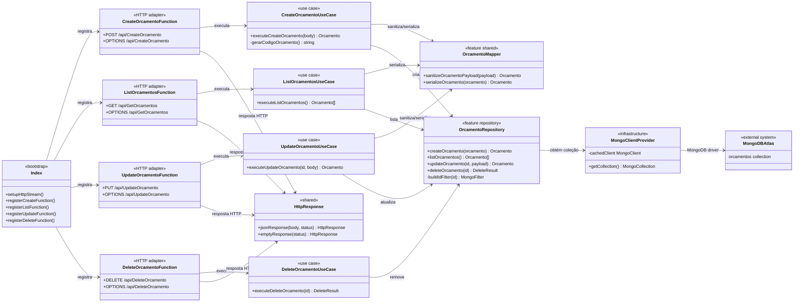
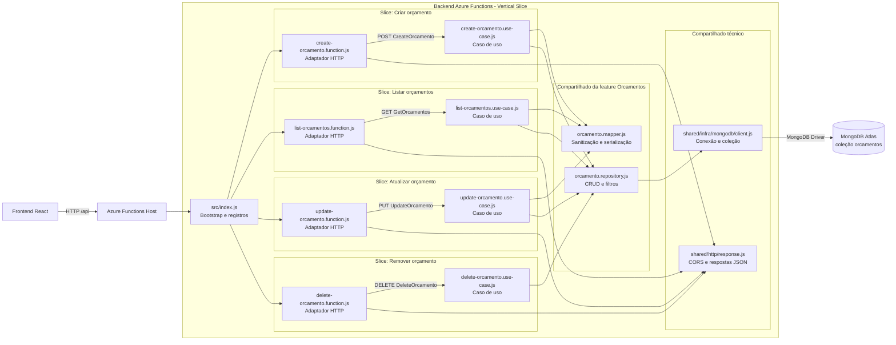

# Arquitetura do Backend — Vertical Slice

Este documento descreve a arquitetura atual do backend em Azure Functions Node.js. A organização é feita por **caso de uso**: cada operação do recurso `Orçamento` mantém seu adaptador HTTP e sua regra de aplicação próximos, em vez de agrupar todo o projeto apenas por camadas técnicas.

## Estrutura por feature

```text
src/
├── index.js
├── shared/
│   ├── http/response.js
│   └── infra/mongodb/client.js
└── features/
    └── orcamentos/
        ├── shared/
        │   ├── orcamento.mapper.js
        │   └── orcamento.repository.js
        ├── create/
        │   ├── create-orcamento.function.js
        │   └── create-orcamento.use-case.js
        ├── list/
        │   ├── list-orcamentos.function.js
        │   └── list-orcamentos.use-case.js
        ├── update/
        │   ├── update-orcamento.function.js
        │   └── update-orcamento.use-case.js
        └── delete/
            ├── delete-orcamento.function.js
            └── delete-orcamento.use-case.js
```

## Diagrama de classes/módulos

Embora o backend use módulos CommonJS e funções — não classes orientadas a objeto — o diagrama abaixo representa os módulos como classes UML para evidenciar suas responsabilidades e dependências.



## Diagrama de componentes



## Responsabilidades dos componentes

| Componente | Responsabilidade |
|---|---|
| `src/index.js` | Configura HTTP streaming e importa os adaptadores, fazendo o registro explícito das Azure Functions. |
| `*.function.js` | Atua como adaptador de entrada: define método, autenticação, leitura da requisição, logs, códigos HTTP e respostas. |
| `*.use-case.js` | Implementa o fluxo de aplicação de um único caso de uso. |
| `orcamento.mapper.js` | Remove `_id` de payloads persistíveis e converte `ObjectId` para string nas respostas. |
| `orcamento.repository.js` | Executa operações de persistência e converte o identificador recebido no filtro MongoDB apropriado. |
| `shared/http/response.js` | Padroniza JSON, CORS e a versão exposta nas respostas. |
| `shared/infra/mongodb/client.js` | Cria e reutiliza a conexão MongoDB; também seleciona banco e coleção pelas variáveis de ambiente. |

## Fluxo de uma requisição

1. O frontend chama uma rota HTTP exposta pelo Azure Functions Host.
2. O `index.js` já registrou o adaptador correspondente durante a inicialização.
3. O adaptador HTTP valida os dados mínimos da requisição e delega ao caso de uso da mesma slice.
4. O caso de uso aplica as regras necessárias e usa o mapper/repositório da feature.
5. O repositório obtém a coleção pelo cliente MongoDB e executa a operação.
6. O adaptador traduz o resultado para a resposta JSON com CORS e o contrato HTTP já existente.

## Endpoints mantidos

| Caso de uso | Azure Function | Método | Rota padrão |
|---|---|---|---|
| Criar orçamento | `CreateOrcamento` | `POST` | `/api/CreateOrcamento` |
| Listar orçamentos | `GetOrcamentos` | `GET` | `/api/GetOrcamentos` |
| Atualizar orçamento | `UpdateOrcamento` | `PUT` | `/api/UpdateOrcamento` |
| Remover orçamento | `DeleteOrcamento` | `DELETE` | `/api/DeleteOrcamento` |

Todas as operações também aceitam `OPTIONS` para o preflight CORS.
